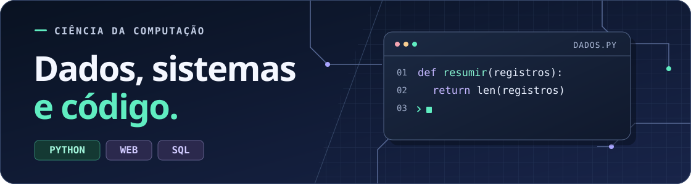
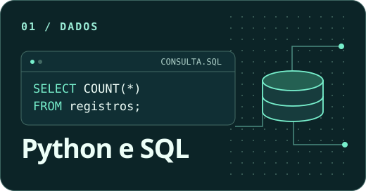
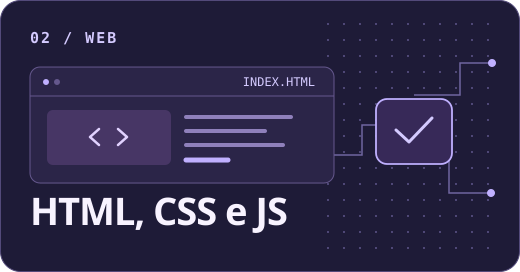

# Nicolas Maronn Justen

Olá, Meu nome é Nicolas, e eu estou cursando a graduação **Ciência da Computação na URI Santo Ângelo** e trabalho na área administrativa da **Dasul Transporte de Cargas**. Minha rotina envolve sistemas de gestão, organização de dados e atendimento a clientes. Meu objetivo é poder me expecializar e poder se tornar um Desenvolvedor.

## Programação

- **Python** · Lógica de programação e resolução de problemas.
- **HTML, CSS e JavaScript** · Estrutura, estilo e interatividade de páginas web.
- **SQL** · Fundamentos de bancos de dados e consultas.

## Experiência profissional

**Funcionário administrativo · Dasul Transporte de Cargas Ltda.**  
Desde maio de 2023

- Cadastro e atualização de dados no sistema da empresa.
- Elaboração de relatórios e planilhas para o controle administrativo.
- Atendimento a clientes por canais digitais, telefone e presencialmente, com esclarecimento de dúvidas.
- Organização e digitalização de arquivos e registros para consulta da equipe.
- Participação em reuniões e apoio na elaboração de atas e no registro de informações.
- Gestão de equipe, com atuação em recrutamento e treinamento.
- Correção e encaminhamento dos registros de jornada dos motoristas.

## Formação acadêmica

**Ciência da Computação · URI, Campus de Santo Ângelo**  
6º semestre · Desde fevereiro de 2024

- Diagnóstico de falhas, identificação de erros e resolução de problemas técnicos.
- Conhecimentos em Windows e sistemas de gestão empresarial (ERP).
- Noções de redes de computadores, incluindo TCP/IP e DNS.

## Contato e idiomas

**E-mail profissional** · [nicolasjustenprofissional@gmail.com](mailto:nicolasjustenprofissional@gmail.com)  
**Idiomas** · Português nativo e inglês básico (A2)

## Galeria

Ver imagens decorativas

  
  

<!-- Para personalizar a galeria, adicione suas imagens a assets/ e inclua novas tags img com texto alternativo. -->

