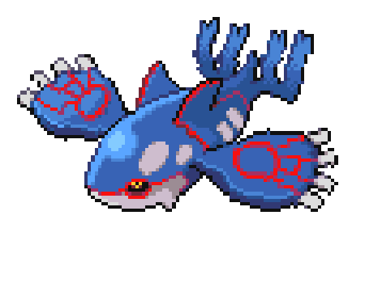
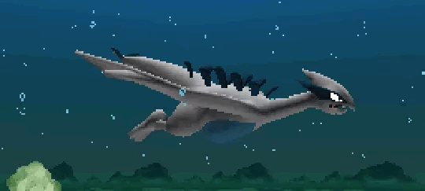

<!--
    Dear user using my README as a base
    to create your own, I’m happy to authorize its use 
    and I’m glad you liked it! I just kindly ask for one thing:

    Please, leave a star on my README it would truly make my day :)
    GitHub: https://github.com/Glauedson
-->

<!-- Banner  -->

  <a href="https://api.github-star-counter.workers.dev/user/Glauedson">
     
  </a>
  <a href="https://api.github-star-counter.workers.dev/user/Glauedson">
     
  </a>

 

<!-- Apresentação -->

### Olá, eu sou o Nicolas! 👋

**Estudante de Ciência da Computação · Desenvolvedor em formação**

Curso **Ciência da Computação na URI, Campus de Santo Ângelo**, e trabalho na área administrativa da **Dasul Transporte de Cargas**. No dia a dia, lido com sistemas de gestão, organização de dados e atendimento a clientes.

Assim como em uma jornada Pokémon, cada desafio é uma oportunidade de evoluir. Meu próximo objetivo é me especializar em **desenvolvimento de software**, conectando o aprendizado da graduação à experiência profissional.

 

## 🎯 Experiência profissional

**Funcionário administrativo · Dasul Transporte de Cargas Ltda.**  
Desde maio de 2023

- **Dados e controles:** cadastro e atualização de informações no sistema, elaboração de relatórios e planilhas administrativas.
- **Atendimento:** suporte a clientes por canais digitais, telefone e presencialmente, com esclarecimento de dúvidas.
- **Documentação:** organização e digitalização de arquivos, apoio em reuniões e elaboração de atas.
- **Equipe:** atuação em gestão, recrutamento e treinamento.
- **Rotinas operacionais:** correção e encaminhamento dos registros de jornada dos motoristas.

## 🎓 Formação acadêmica

**Ciência da Computação · URI, Campus de Santo Ângelo**  
6º semestre · Início em fevereiro de 2024

Em formação para atuar no desenvolvimento de software, ampliando meus conhecimentos em programação e resolução de problemas.

## ⚡ Meu time de tecnologias

<table width="100%">
  <tr>
    <td valign="top" width="45%">
      
      <strong>Tecnologias em evolução</strong>
      
Linguagens e tecnologias que fazem parte da minha jornada de aprendizado.

       
       
    </td>
    <td valign="top" width="55%">
      <strong>Conhecimentos de apoio</strong>
      <ul>
        <li>Diagnóstico de falhas e resolução de problemas técnicos.</li>
        <li>Windows e sistemas de gestão empresarial (ERP).</li>
        <li>Noções de redes de computadores, TCP/IP e DNS.</li>
        <li>Organização de dados, relatórios e planilhas.</li>
      </ul>
    </td>
  </tr>
</table>

## 📫 Vamos nos conectar

Trocar experiências e aprender com outras pessoas também faz parte da jornada.

<!-- badges -->

  <!-- Linkedin -->
  
  <!-- GMail  -->
  

 

<em>Um desafio por vez, sempre em evolução.</em>

